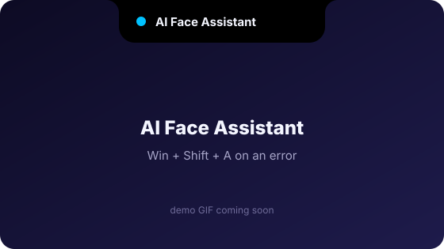
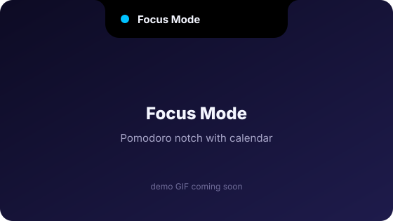
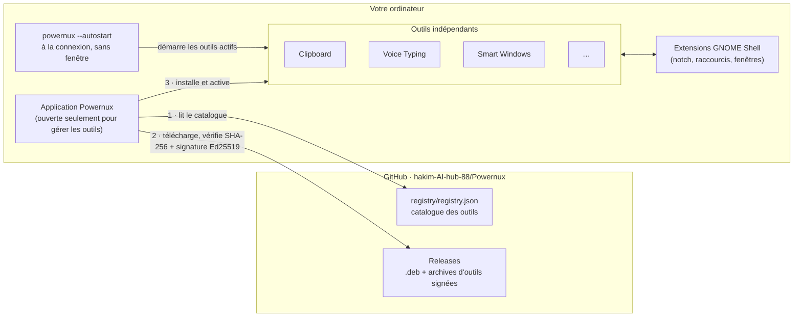

<div align="center">



<br>


<br><br>

[](https://github.com/hakim-AI-hub-88/Powernux/releases/latest)
[](https://github.com/hakim-AI-hub-88/Powernux/releases)
[](LICENSE)
<br>


<br>

<a href="https://github.com/hakim-AI-hub-88/Powernux/releases/latest/download/powernux_amd64.deb">
  
</a>

<sub><a href="https://github.com/hakim-AI-hub-88/Powernux/releases">Toutes les versions</a> · <a href="README.md">🇬🇧 Read in English</a></sub>

</div>

---

## ✨ Pourquoi Powernux ?

Powernux réunit dans **une seule application moderne** les petits utilitaires qui font gagner du temps au quotidien
sur Linux. L'application elle-même est minuscule : **chaque outil est un module indépendant**, que vous installez
en un clic, activez ou désactivez, et qui fonctionne en arrière-plan **sans garder Powernux ouvert**.

- 🧩 **Modulaire** — installez uniquement ce dont vous avez besoin ; les outils viennent de GitHub et se mettent à jour.
- 🪶 **Léger** — seuls les outils actifs tournent ; Powernux ne s'ouvre que pour changer un réglage.
- ⌨️ **Pensé pour le clavier** — chaque outil a un raccourci global, dans n'importe quelle application.
- 🔒 **Sûr** — outils signés, politique de sécurité stricte, clés API dans le trousseau GNOME.
- 🌍 **Français et anglais** — toute l'interface, choix conservé entre les redémarrages.

## 🎬 Démonstration

<table>
  <tr>
    <td width="50%"></td>
    <td width="50%"></td>
  </tr>
  <tr>
    <td width="50%"></td>
    <td width="50%"></td>
  </tr>
</table>

## 🧰 Les outils

| | Outil | Ce qu'il fait | Raccourci |
|:-:|---|---|:-:|
|  | **Clipboard Manager** | Historique du presse-papiers avec épinglage — ignore les mots de passe des gestionnaires de mots de passe | <kbd>Win</kbd> + <kbd>Shift</kbd> + <kbd>V</kbd> |
|  | **Smart Window Manager** | Fenêtre toujours au premier plan avec bordure, organisation automatique (grille, 70 / 30…), espaces de travail restaurés par raccourci | <kbd>Win</kbd> + <kbd>Shift</kbd> + <kbd>T</kbd> / <kbd>O</kbd> |
|  | **Voice Typing** | Maintenez, parlez, relâchez : transcrit, copié et collé pour vous (Groq, OpenAI, AssemblyAI ou votre API) | maintenir <kbd>Win</kbd> + <kbd>E</kbd> |
|  | **AI Face Assistant** | Un visage IA animé dans un notch explique vos erreurs et propose la correction (Groq, OpenAI, Gemini, Mistral, OpenRouter, Ollama) | <kbd>Win</kbd> + <kbd>Shift</kbd> + <kbd>A</kbd> |
|  | **Focus Mode** | Sessions de concentration et Pomodoro : ouvre vos applications, coupe les notifications, bloque les distractions | <kbd>Win</kbd> + <kbd>Shift</kbd> + <kbd>F</kbd> |
|  | **Notes** | Bloc-notes structuré : carnets, titres, cases à cocher, recherche | <kbd>Win</kbd> + <kbd>Shift</kbd> + <kbd>N</kbd> |
|  | **Screenshot** | Capture d'une zone, d'une fenêtre ou de l'écran, copiée dans le presse-papiers | <kbd>Win</kbd> + <kbd>Shift</kbd> + <kbd>S</kbd> |
|  | **Project Dashboard** | Vos projets avec leurs technologies et leur dernière modification ; ouverture dans VS Code, le terminal, ou lancement | — |
|  | **Smart File Organizer** | Range un dossier par type et trouve les fichiers en double (corbeille, annulation possible) | — |
|  | **AI Copilot** | Assistant IA du bureau dans un notch, lié au terminal et à l'écran | *bientôt* |

## 🚀 Installation

Nécessite **Ubuntu 24.04 ou plus récent** (ou une autre distribution avec **GNOME 45 à 50**), x86-64.

```bash
wget https://github.com/hakim-AI-hub-88/Powernux/releases/latest/download/powernux_amd64.deb
sudo apt install ./powernux_amd64.deb
powernux
```

Ouvrez ensuite le **Gestionnaire d'outils** et cliquez sur **Télécharger** pour les outils voulus — c'est tout.
Les outils liés à GNOME Shell (Smart Windows, Voice Typing, Focus Mode, AI Face) demandent de
**se déconnecter puis se reconnecter une fois** après leur première installation.

## 🏗️ Fonctionnement



## 🔒 Vie privée et sécurité

- **Ni compte, ni statistiques, ni télémétrie.** Les données ne quittent votre ordinateur que vers le service que
  *vous* choisissez (par exemple votre voix vers le service de transcription choisi) — voir **[PRIVACY.md](PRIVACY.md)**.
- **Outils signés** : Powernux refuse tout outil dont la signature Ed25519 ou l'empreinte SHA-256 ne correspond pas.
- **Clés API** chiffrées dans le **trousseau GNOME**, jamais renvoyées à l'interface.
- **Clipboard Manager** ignore les copies marquées « secret » par les gestionnaires de mots de passe et peut effacer son historique automatiquement.
- Une faille ? Signalez-la en privé — voir **[SECURITY.md](SECURITY.md)**.

## ❓ Questions fréquentes

<details>
<summary><b>Pourquoi faut-il se déconnecter puis se reconnecter une fois ?</b></summary>

Sous Wayland, seul GNOME Shell peut agir sur les fenêtres des autres applications, le clavier ou le haut de l'écran.
Des outils comme Smart Windows ou Voice Typing installent donc une petite extension GNOME Shell, et GNOME ne charge
les nouvelles extensions qu'à la connexion. Une seule fois par outil.
</details>

<details>
<summary><b>Où mettre mes clés API ? Sont-elles en sécurité ?</b></summary>

Dans les réglages de l'outil (par exemple *Voice Typing → Clé API Groq*). Elles sont chiffrées dans le trousseau
GNOME et lues uniquement par l'outil qui en a besoin. Pour tout garder en local, utilisez **Ollama** avec AI Face :
aucune clé, rien n'est envoyé.
</details>

<details>
<summary><b>Powernux consomme-t-il beaucoup de ressources ?</b></summary>

Non. À la connexion, `powernux --autostart` démarre seulement les outils activés et se ferme en une demi-seconde.
La fenêtre Powernux ne s'ouvre que pour gérer les outils. Notes, par exemple, n'utilise rien quand il est fermé.
</details>

<details>
<summary><b>Peut-on changer les raccourcis ?</b></summary>

Tous, dans les réglages de chaque outil — Powernux prévient si un raccourci est déjà utilisé par GNOME ou un autre outil.
Chaque espace de travail de Smart Window Manager peut avoir son propre raccourci (par exemple <kbd>Win</kbd> + <kbd>Alt</kbd> + <kbd>1</kbd> → « Coding »).
</details>

<details>
<summary><b>Comment désinstaller ?</b></summary>

**Paramètres → Tout désinstaller** (supprime outils, données, clés, raccourcis, extensions et démarrage automatique), puis :

```bash
sudo apt remove powernux
```
</details>

## 🛠️ Compiler depuis les sources

```bash
git clone https://github.com/hakim-AI-hub-88/Powernux.git && cd powernux
npm install
npm run tauri dev      # lancer en développement
npm run tauri build    # créer le .deb / .rpm / .AppImage
```

Guide développeur (architecture, protocole des outils, publication) : **[docs/DEVELOPMENT.md](docs/DEVELOPMENT.md)**.

## 🧩 Créer votre propre outil

Un outil est un programme indépendant accompagné d'un `manifest.json`. Powernux génère sa page de réglages tout seul :

```json
{
  "id": "mon-outil",
  "name": "Mon outil",
  "version": "1.0.0",
  "entry": "mon-outil",
  "settings": [
    { "key": "shortcut", "type": "shortcut", "label": "Raccourci", "default": "<Super><Shift>m" }
  ],
  "shortcuts": [{ "setting": "shortcut", "name": "Mon outil", "args": ["--show"] }]
}
```

Le programme reçoit `--reload` quand un réglage change et `--quit` quand il est désactivé.
`npm run package:mon-outil` le compile, le **signe** et l'ajoute au catalogue.

## 👤 Auteur

**Es-somid Abdelhakim** — Étudiant ingénieur

[](https://ma.linkedin.com/in/abdelhakim-essomid)
[](https://github.com/hakim-AI-hub-88)

Si Powernux vous fait gagner du temps, une ⭐ sur le dépôt aide beaucoup !

## 📄 Licence

[MIT](LICENSE) © 2026 Es-somid Abdelhakim · Composants tiers : [THIRD-PARTY-NOTICES.md](THIRD-PARTY-NOTICES.md)
