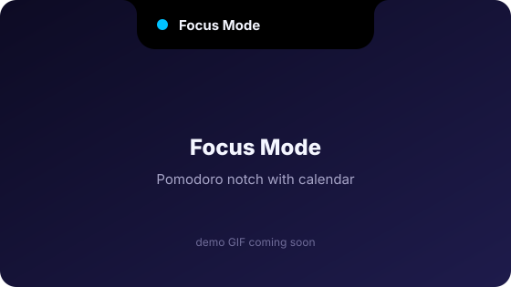
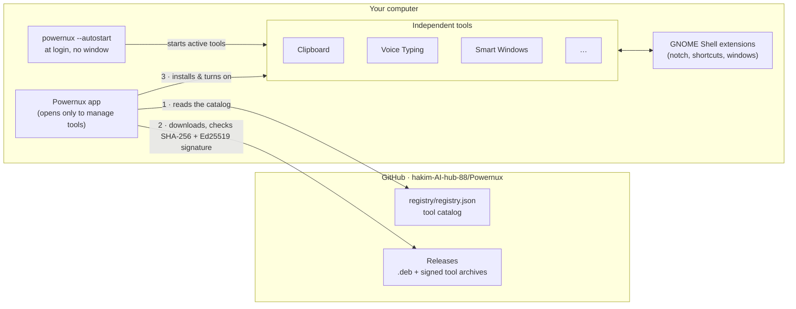

<div align="center">



<br>


<br><br>

[](https://github.com/hakim-AI-hub-88/Powernux/releases/latest)
[](https://github.com/hakim-AI-hub-88/Powernux/releases)
[](LICENSE)
<br>


<br>

<a href="https://github.com/hakim-AI-hub-88/Powernux/releases/latest/download/powernux_amd64.deb">
  
</a>

<sub><a href="https://github.com/hakim-AI-hub-88/Powernux/releases">All releases</a> · <a href="README.fr.md">🇫🇷 Lire en français</a></sub>

</div>

---

## ✨ Why Powernux?

Powernux brings the small utilities that save you time every day into **one modern app** for the Linux desktop.
The app itself is tiny: **every tool is an independent module** that you install with one click, turn on or off,
and that runs in the background **without keeping Powernux open**.

- 🧩 **Modular** — install only what you need; tools are downloaded from GitHub and updated automatically.
- 🪶 **Light** — only active tools run; Powernux opens only when you want to change something.
- ⌨️ **Keyboard-first** — every tool has a global shortcut that works in any application.
- 🔒 **Safe** — signed tools, strict Content Security Policy, API keys in the GNOME Keyring.
- 🌍 **English & French** — the whole interface, saved across restarts.

## 🎬 Demo

<table>
  <tr>
    <td width="50%"></td>
    <td width="50%"></td>
  </tr>
  <tr>
    <td width="50%"></td>
    <td width="50%"></td>
  </tr>
</table>

## 🧰 Tools

| | Tool | What it does | Shortcut |
|:-:|---|---|:-:|
|  | **Clipboard Manager** | Clipboard history with pinning — ignores passwords copied from password managers | <kbd>Win</kbd> + <kbd>Shift</kbd> + <kbd>V</kbd> |
|  | **Smart Window Manager** | Always-on-top with a colored border, auto-arrange (grid, 70 / 30…), workspaces restored in one shortcut | <kbd>Win</kbd> + <kbd>Shift</kbd> + <kbd>T</kbd> / <kbd>O</kbd> |
|  | **Voice Typing** | Hold, speak, release: transcribed, copied and pasted for you (Groq, OpenAI, AssemblyAI or your own API) | hold <kbd>Win</kbd> + <kbd>E</kbd> |
|  | **AI Face Assistant** | An animated AI face in a notch explains your errors and suggests the fix (Groq, OpenAI, Gemini, Mistral, OpenRouter, Ollama) | <kbd>Win</kbd> + <kbd>Shift</kbd> + <kbd>A</kbd> |
|  | **Focus Mode** | Focus sessions & Pomodoro: opens your apps, mutes notifications, blocks distractions | <kbd>Win</kbd> + <kbd>Shift</kbd> + <kbd>F</kbd> |
|  | **Notes** | Structured notepad: notebooks, headings, checklists, search | <kbd>Win</kbd> + <kbd>Shift</kbd> + <kbd>N</kbd> |
|  | **Screenshot** | Area, window or full-screen capture, copied to the clipboard | <kbd>Win</kbd> + <kbd>Shift</kbd> + <kbd>S</kbd> |
|  | **Project Dashboard** | Your projects with their stack and last change; open in VS Code, the terminal, or run them | — |
|  | **Smart File Organizer** | Sorts a folder by type and finds duplicate files (to the trash, with undo) | — |
|  | **AI Copilot** | Desktop AI assistant in a notch, linked to the terminal and the screen | *coming soon* |

## 🚀 Install

Requires **Ubuntu 24.04 or newer** (or another distribution with **GNOME 45–50**), x86-64.

```bash
wget https://github.com/hakim-AI-hub-88/Powernux/releases/latest/download/powernux_amd64.deb
sudo apt install ./powernux_amd64.deb
powernux
```

Then open **Tools Manager**, click **Download** on the tools you want — that's it.
Tools that integrate with GNOME Shell (Smart Windows, Voice Typing, Focus Mode, AI Face) need you to
**log out and back in once** after their first install.

## 🏗️ How it works



## 🔒 Privacy & security

- **No account, no analytics, no telemetry.** Data leaves your computer only for the service *you* pick
  (e.g. your voice to the transcription service you chose) — see **[PRIVACY.md](PRIVACY.md)**.
- **Signed tools**: Powernux refuses any tool whose Ed25519 signature or SHA-256 does not match.
- **API keys** are stored encrypted in the **GNOME Keyring**, never sent to the interface.
- **Clipboard Manager** ignores copies marked as secret by password managers and can auto-clear its history.
- Found a vulnerability? Please report it privately — see **[SECURITY.md](SECURITY.md)**.

## ❓ FAQ

<details>
<summary><b>Why do I need to log out and back in once?</b></summary>

On Wayland, only GNOME Shell may touch other apps' windows, the keyboard or the top of the screen.
Tools like Smart Windows or Voice Typing therefore ship a small GNOME Shell extension, and GNOME loads new
extensions only at login. You only do it once per tool.
</details>

<details>
<summary><b>Where do I put my API keys? Are they safe?</b></summary>

In the tool's settings (e.g. *Voice Typing → Groq API key*). Keys are stored in the GNOME Keyring (encrypted)
and only read by the tool that needs them. For a fully local setup, use **Ollama** with AI Face — no key, nothing sent.
</details>

<details>
<summary><b>Does Powernux use a lot of resources?</b></summary>

No. At login, `powernux --autostart` starts only the tools you turned on and exits in about half a second.
The Powernux window is opened only to manage tools. Notes, for example, uses nothing at all while it is closed.
</details>

<details>
<summary><b>Which shortcuts can I change?</b></summary>

All of them, in each tool's settings — Powernux warns you if a shortcut is already used by GNOME or another tool.
Workspaces in Smart Window Manager can each have their own shortcut (e.g. <kbd>Win</kbd> + <kbd>Alt</kbd> + <kbd>1</kbd> → "Coding").
</details>

<details>
<summary><b>How do I uninstall?</b></summary>

**Settings → Uninstall everything** (removes tools, data, keys, shortcuts, extensions and startup entry), then:

```bash
sudo apt remove powernux
```
</details>

## 🛠️ Build from source

```bash
git clone https://github.com/hakim-AI-hub-88/Powernux.git && cd powernux
npm install
npm run tauri dev      # run in development
npm run tauri build    # produce the .deb / .rpm / .AppImage
```

Developer guide (architecture, tool protocol, packaging): **[docs/DEVELOPMENT.md](docs/DEVELOPMENT.md)**.

## 🧩 Create your own tool

A tool is an independent program plus a `manifest.json`. Powernux builds its settings page automatically:

```json
{
  "id": "my-tool",
  "name": "My Tool",
  "version": "1.0.0",
  "entry": "my-tool-binary",
  "settings": [
    { "key": "shortcut", "type": "shortcut", "label": "Shortcut", "default": "<Super><Shift>m" }
  ],
  "shortcuts": [{ "setting": "shortcut", "name": "My Tool", "args": ["--show"] }]
}
```

Your program receives `--reload` when settings change and `--quit` when it is turned off.
`npm run package:my-tool` compiles, **signs** and adds it to the catalog.

## 👤 Author

**Es-somid Abdelhakim** — Engineering student

[](https://ma.linkedin.com/in/abdelhakim-essomid)
[](https://github.com/hakim-AI-hub-88)

If Powernux saves you time, a ⭐ on the repository helps a lot!

## 📄 License

[MIT](LICENSE) © 2026 Es-somid Abdelhakim · Third-party components: [THIRD-PARTY-NOTICES.md](THIRD-PARTY-NOTICES.md)
